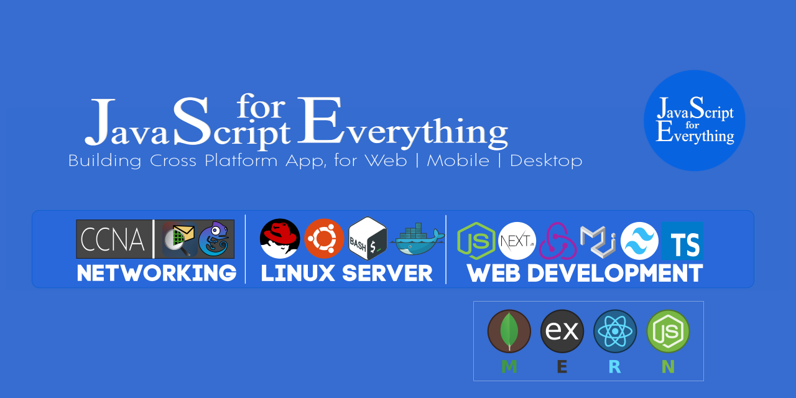

# 👋 Hello, I'm JavaScriptForEverything  
## Full-Stack Web Developer | React | Node.js | Docker | Kubernetes | MERN Stack | Real-Time Apps

🚀 Passionate about building fast, secure, and scalable web apps with modern tools.  
🔁 Experienced in DevOps, large file handling, real-time communication, and clean API architecture.

## 🔧 Tech Stack

**Frontend**: React.js, Next.js, Redux, TypeScript, Tailwind CSS, Material UI  
**Backend**: Node.js, Express.js, MongoDB (Mongoose), Prisma, REST APIs  
**DevOps**: Docker, Kubernetes, NGINX, GitHub Actions, VPS Deployment (Ubuntu/CentOS)  
**Other**: WebRTC, Socket.io, OAuth2, OTP, Email/Payment Integration

---

## 📌 Highlight Projects

- 🔹 **Messenger Clone** – WebRTC video/audio call, file sharing (2GB+), Socket.io chat  
- 🔹 **Multi-Vendor E-Commerce** – Subdomain-based vendor/admin/main, OTP login, payments, Dockerized deployment  
- 🔹 **Twitter Clone** – Real-time social media app with SSR and chat features

➡️ **Live Portfolio:** [javascriptforeverything.vercel.app](https://javascriptforeverything.vercel.app)  
➡️ **YouTube Channel:** [youtube.com/@riajul-businessnify](https://youtube.com/@riajul-businessnify)  
➡️ **GitHub:** [github.com/JavaScriptForEverything](https://github.com/JavaScriptForEverything)

---

## 📊 GitHub Stats

---

## 🤝 Let's Connect

---

> 🎯 Open to freelance, remote roles, collaborations, and open-source contributions in Full-Stack Development and DevOps.

